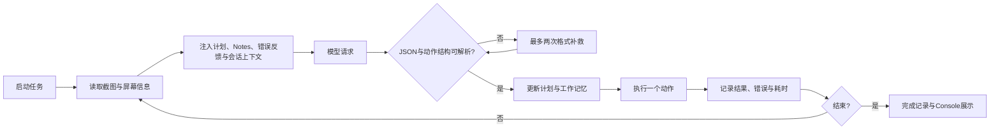

# onDevice Agent 原项目与安卓端设计复核

审查日期：2026-10-29。

审查范围：本地 `origin/main` / HEAD `a8e909e` 中的原 iOS Runner、Console，以及当前安卓 0.1.1 源码。没有拉取远端更新，因此不是对 GitHub 最新版本的判断。原项目的 `OnDeviceAgentWebUI.m` 和 WebDriverAgent 子模块已有本地修改，本轮不将它们当作未修改的上游代码，也不改动这些文件。

本轮只新增本报告，没有修改应用代码、重新打包或安装。手机未连接，没有新增真机证据。

## 1. 原项目值得保留的设计

原项目不只是一个 system prompt。它包含执行循环、计划记忆、模型适配、动作执行、停止与错误恢复、运行记录，以及独立的 Console 展示层。

其中几个关键点：

- `OnDeviceAgentMemory.m` 为计划项分配稳定 ID，按 ID 或归一化文字匹配，保留旧文字；反馈给模型时包含 ID。
- Chat Completions 保存并裁剪会话；Responses 使用 `previous_response_id`，还可以在计划取得进展后重启响应链，携带检查点继续执行。
- 网络层保存 `inflightTask`，可以取消正在等待的请求。
- 格式补救不会修改正常计划；动作错误和执行耗时进入 trace。
- Console 提供 `ActionOverlay.swift`，能把点击和滑动叠加到截图上。
- 有单独的访问授权、Keychain 和原始数据脱敏模块。

这些能力值得有选择地移植。但原版同样依赖模型判断完成状态，并非天然具备业务结果校验或防重复提交保证，不应完整照搬后就认为可靠性已经解决。

## 2. 需要优先处理的正确性问题

### 2.1 中途回桌面可能被误判为任务成功〔P1，源码确认〕

依据：[AgentRuntime.kt:501](/Users/danhua/project/manila/ios-wda-ondevice-agent/apps/OnDeviceAgentAndroid/app/src/main/java/com/ondeviceagent/android/runtime/AgentRuntime.kt:501)、[AgentRuntime.kt:565](/Users/danhua/project/manila/ios-wda-ondevice-agent/apps/OnDeviceAgentAndroid/app/src/main/java/com/ondeviceagent/android/runtime/AgentRuntime.kt:565)。

当前任意一次成功 Launch 之后，只要成功执行 Home，就设置 `expectFinishAfterHome=true`。之后模型若输出 Launch、Tap、Swipe 等动作，会被直接转成成功完成。这个分支没有限定原任务必须以“回桌面”为目标。

可由代码推导的触发序列：启动业务应用 → 页面走错 → Home 作为恢复 → 尝试重新 Launch → 被自动判成功。此时打卡等实际目标可能尚未完成，还会取消失败重试，并可能发送成功通知。

建议：删除泛化的 Home 自动成功规则；若保留便利规则，必须同时满足明确的终止目标和已验证的业务检查点，不能把动作类型当成完成证据。

验收：`Launch → Home → Launch` 对普通业务任务不能结束；真正“打开设置后返回桌面”的任务仍能正常结束。

### 2.2 Finish 无法区分成功、失败和需要人工协助〔P1，原版也存在此限制〕

依据：[AgentRuntime.kt:519](/Users/danhua/project/manila/ios-wda-ondevice-agent/apps/OnDeviceAgentAndroid/app/src/main/java/com/ondeviceagent/android/runtime/AgentRuntime.kt:519)。默认 prompt 又要求遇到无法自动处理的验证码或权限问题时用 Finish 说明。

当前任何 Finish 都设置 `success=true`。模型输出“需要用户手动处理”也会进入成功历史，并取消后续重试。

建议：终态至少区分 `success / failed / blocked / cancelled`，Finish 提供明确状态及结果证据。业务成功必须能对应“打卡成功”等可核对信息；人工协助属于 blocked，不自动重复提交。

验收：Finish 表示人工协助时不能出现成功通知，历史必须能显示阻塞原因。兼容旧 Finish 协议时需要单独设计迁移，避免一次性破坏现有接口。

### 2.3 暂停、编辑或取消与启动之间存在竞争〔P1，包含新加重试的缺口〕

依据：[ScheduledRunCoordinator.kt:66](/Users/danhua/project/manila/ios-wda-ondevice-agent/apps/OnDeviceAgentAndroid/app/src/main/java/com/ondeviceagent/android/schedule/ScheduledRunCoordinator.kt:66)、[ScheduledRunCoordinator.kt:117](/Users/danhua/project/manila/ios-wda-ondevice-agent/apps/OnDeviceAgentAndroid/app/src/main/java/com/ondeviceagent/android/schedule/ScheduledRunCoordinator.kt:117)、[AgentRuntime.kt:118](/Users/danhua/project/manila/ios-wda-ondevice-agent/apps/OnDeviceAgentAndroid/app/src/main/java/com/ondeviceagent/android/runtime/AgentRuntime.kt:118)。

普通调度读取 task 后会等待亮屏约 800 ms，随后仍按旧 task 决定标记触发、清除单次计划或启动。期间用户若把单次计划改成每周，旧分支仍可能清掉新计划；若只暂停而任务文字未变，启动函数只校验 ID 和文字，仍可能开始执行。

重试分支也类似：读取到期重试后，等待 runtime 状态期间，用户可以取消该重试；随后 `start(isRetry=true)` 没有要求当前仍存在同一个待重试记录。

上一轮增加的 `executionRevision` 主要防止旧执行结束后给新版本重新安排重试，尚未完整保护“启动前领取任务”这一阶段。

建议：建立单一的任务领取入口，在同一个状态转换中复核 `taskId + executionRevision + occurrenceId / retrySourceRunId + enabled + dueAt`，领取成功后才允许启动；修改和取消使旧领取资格失效。

验收：在等待亮屏时暂停、改时间、改单次为每周，均不能执行或清除新计划；取消待重试与启动并发时，必须有唯一且可解释的结果。

### 2.4 启动执行后又把管理界面拉到前台〔P1，存在时序风险，触发率待真机验证〕

依据：[ScheduleWakeActivity.kt:51](/Users/danhua/project/manila/ios-wda-ondevice-agent/apps/OnDeviceAgentAndroid/app/src/main/java/com/ondeviceagent/android/schedule/ScheduleWakeActivity.kt:51)、[ScheduleWakeActivity.kt:57](/Users/danhua/project/manila/ios-wda-ondevice-agent/apps/OnDeviceAgentAndroid/app/src/main/java/com/ondeviceagent/android/schedule/ScheduleWakeActivity.kt:57)。

WakeActivity 调用协调器后，协调器通过 runtime.start 启动异步循环；返回后 WakeActivity 又显式拉起 MainActivity。此时执行循环可能已经截图、调用模型，甚至已经切换到业务应用，后来的 MainActivity 会改变前台。

AlarmReceiver、前台服务和 WakeActivity 还都有亮屏或启动入口。不能据此认定一定发生无限递归，但多入口会增加重复启动、前台切换与排查难度。

建议：顺序收敛为“领取任务 → 亮屏/解锁 → 启动页收尾 → 执行循环”。管理界面不得在执行启动后抢前台。所有入口只转交一次启动事件，由同一协调器处理。

验收：记录首帧、前台 package、运行启动和 Activity 切换时间，确认系统拉起完成后才进入第一步执行。覆盖锁屏、亮屏、重复广播和两个计划临近的情况。

### 2.5 进程意外结束后缺少运行状态对账〔P1，安卓生命周期问题〕

依据：[OnDeviceAgentApp.kt:22](/Users/danhua/project/manila/ios-wda-ondevice-agent/apps/OnDeviceAgentAndroid/app/src/main/java/com/ondeviceagent/android/OnDeviceAgentApp.kt:22)、[AgentRuntime.kt:163](/Users/danhua/project/manila/ios-wda-ondevice-agent/apps/OnDeviceAgentAndroid/app/src/main/java/com/ondeviceagent/android/runtime/AgentRuntime.kt:163)。

运行中状态保存在 runtime 内存，任务卡片的 lastRun 却会持久化。应用重新创建时主要恢复配置和重新注册闹钟，没有处理上次“仍为 running 但进程已不存在”的执行。已开始的补跑也已经消费 pendingRetry 时间。

因此，系统终止进程后，可能出现卡片仍显示 running、运行记录没有完成时间，也没有明确触发失败重试的情况。这里的系统终止与用户主动强行停止需要分开处理，不能把所有重启都当作允许自动恢复。

建议：持久化 runId、任务版本、开始时间和当前阶段；启动时将未正常结束的记录对账为 interrupted。是否补跑再受原任务时间窗口、重试额度和用户意图约束，不能直接重复提交。

验收：真实终止进程后重启，界面状态一致、历史有中断原因；用户主动停止后不自行恢复。

## 3. 与定位、长任务稳定性直接相关的改进

### 3.1 需要验证动作结果，而不只是动作派发〔P1，仍有明显设计缺口〕

依据：[AgentRuntime.kt:532](/Users/danhua/project/manila/ios-wda-ondevice-agent/apps/OnDeviceAgentAndroid/app/src/main/java/com/ondeviceagent/android/runtime/AgentRuntime.kt:532)、[AgentRuntime.kt:556](/Users/danhua/project/manila/ios-wda-ondevice-agent/apps/OnDeviceAgentAndroid/app/src/main/java/com/ondeviceagent/android/runtime/AgentRuntime.kt:556)。

现有“旧观察”保护仅检查 package 和屏幕尺寸。同一应用里的页面跳转、弹窗、滚动、键盘变化，可能保持二者不变；此时旧坐标仍可被执行。

连续失败计数也只统计 `actionResult.ok=false`。点错了按钮但系统成功接收手势时 ok 仍为 true，不会被三次失败上限制止。

建议增加：

- 页面观测编号，包含窗口/Activity 线索、关键可交互节点及布局摘要；执行前复核目标仍存在。
- 动作后的结果核对，例如预期文字出现、目标页面变化、输入框内容状态变化。
- 针对相同目标、相似页面连续无进展的检测和有限恢复策略。摘要应忽略时钟等动态信息，不能把每个像素变化都当作页面变化。
- 截图不可用且没有可用节点时，执行器拒绝盲目的坐标点击，而非只依赖 prompt 提醒。
- Type 默认要求明确且可用的输入目标。当前焦点缺失时会递归取第一个 editable 节点，可能写进错误输入框，应改为明确定位或报告歧义。

这部分比继续添加更多“请准确点击”的 prompt 文案更有价值。

### 3.2 计划 ID 没有形成闭环，重复规划仍可能出现〔P1/P2〕

依据：[ActionParser.kt:100](/Users/danhua/project/manila/ios-wda-ondevice-agent/apps/OnDeviceAgentAndroid/app/src/main/java/com/ondeviceagent/android/llm/ActionParser.kt:100)、[AgentRuntime.kt:722](/Users/danhua/project/manila/ios-wda-ondevice-agent/apps/OnDeviceAgentAndroid/app/src/main/java/com/ondeviceagent/android/runtime/AgentRuntime.kt:722)。

安卓解析了模型的计划 ID，但不会主动给缺失 ID 的项分配稳定 ID。向模型回传清单时也只发送序号、done 和文字，丢掉了 ID。文字匹配要求完全相同，而且合并时可以把旧文字替换为新文字；模型改写句子就可能被追加为新项。

原版提供了更完整的做法：生成 ID、按归一化文字兜底、保留旧文字、下一轮继续提供 ID。这能减少标点或措辞轻微变化造成的重复，但也不能解决任意语义改写，不能把它描述成完整语义去重。

建议先移植确定性的 ID 闭环和稳定文本，再考虑有限的相似项提示。不要直接按语义相似度自动合并两个可能独立的业务步骤。

验收：多步运行中仅修改标点或返回原 ID 时，条目数量不增长；当前步骤需要修正时有明确规则，而不是无限追加新步骤。

### 3.3 5 分钟重试还需要有效期与提交检查点〔P1/P2，新功能的后续补强〕

依据：[FailureRetryPolicy.kt:7](/Users/danhua/project/manila/ios-wda-ondevice-agent/apps/OnDeviceAgentAndroid/app/src/main/java/com/ondeviceagent/android/manager/FailureRetryPolicy.kt:7)、[ManagerStore.kt:139](/Users/danhua/project/manila/ios-wda-ondevice-agent/apps/OnDeviceAgentAndroid/app/src/main/java/com/ondeviceagent/android/manager/ManagerStore.kt:139)。

一次重试上限已经存在，但忙碌时的多次延后没有截止时间。时间敏感任务可能在原有效窗口很久以后才运行。

恢复上下文目前是计划和 Notes 的文本线索，没有提交前后检查点，也没有把重试来源关联到历史展示。打卡已成功但最后一个模型响应解析失败时，整项补跑仍可能重复尝试提交。

建议：

- 每次计划有独立 occurrenceId 和截止时间，重试只属于该次计划。
- 区分短暂网络错误、格式错误、认证失败、缺权限、人工验证码等原因。401/403 或需人工授权不应与临时服务错误使用同一恢复策略。
- 提交前写入 pending 检查点，确认结果后写入 confirmed；重试先验证 pending 的业务结果，再决定是否提交。
- 区分“实际执行次数”和“因占用而等待次数”；超过有效期后留下明确历史，不再补跑。

原版的 ledger / checkpoint prompt 可借鉴，但单靠 prompt 仍不是业务应用的幂等保证。

## 4. 模型、接口和诊断层的改进

### 4.1 会话记忆与模型兼容层〔P2〕

当前独立请求模式可以继续保留，不必强制所有模型支持 Responses 链。但应实现两类明确模式：

1. 无状态模式：当前任务、稳定计划、有限动作结果、已验证检查点组成结构化摘要。
2. 会话模式：有界历史或 Responses 链，在计划完成和上下文达到预算时压缩/重启。

`doubaoSeedEnableSessionCache`、`restartResponsesByPlan`、`useW3cActionsForSwipe` 当前主要停留在配置/序列化层，不能向用户暗示都已生效。应接线实现、标注不支持，或者从安卓配置契约中逐步移除。

当前已记录 `finishReason`，但还未用它区分 token 截断、空输出、拒绝和格式错误。格式补救请求里的网络失败也会落入 parse_error 分支，分类需要更细。

网络层每次调用创建新 OkHttpClient，使用阻塞 execute，没有将协程取消与 Call.cancel 明确绑定，也未设置整次调用的 callTimeout。原版持有可取消的 inflightTask。建议复用客户端、实现可取消请求、设置单请求和整项任务预算，避免“已点击停止但请求仍占用资源”的情况。

### 4.2 本地 API 授权缺口〔P1，取决于网络可达性，与此前四项 lint 不同〕

依据：[AgentHttpServer.kt:23](/Users/danhua/project/manila/ios-wda-ondevice-agent/apps/OnDeviceAgentAndroid/app/src/main/java/com/ondeviceagent/android/runtime/AgentHttpServer.kt:23)、[AgentHttpServer.kt:134](/Users/danhua/project/manila/ios-wda-ondevice-agent/apps/OnDeviceAgentAndroid/app/src/main/java/com/ondeviceagent/android/runtime/AgentHttpServer.kt:134)。

安卓 HTTP 服务绑定 `0.0.0.0:8100`，路由没有执行 Agent Token 检查，包括 action、stop、config、factory_reset。虽然配置模型里有 agentToken，不能据此认为鉴权已经生效。

原版有单独的授权函数：非本机访问需要匹配 Token。当前安卓如果端口可从所在网络到达，就存在未授权调用这些接口的路径；本次没有做网络探测，不能断言手机已经被他人访问。

对于个人 USB 使用，建议默认只绑定 loopback，继续通过 adb forward 访问；显式启用局域网模式后再要求 Token。这是具体代码缺口，不是上次四个静态报错的重新解释。

### 4.3 运行记录要支持“解释为什么点错”〔P2〕

依据：[HistoryScreen.kt:255](/Users/danhua/project/manila/ios-wda-ondevice-agent/apps/OnDeviceAgentAndroid/app/src/main/java/com/ondeviceagent/android/ui/HistoryScreen.kt:255)、[TraceRecorder.kt:93](/Users/danhua/project/manila/ios-wda-ondevice-agent/apps/OnDeviceAgentAndroid/app/src/main/java/com/ondeviceagent/android/trace/TraceRecorder.kt:93)。

完整原始输出已经保存，但历史界面没有展示 model-step-attempt 诊断文件，步骤卡片仅显示模型文本前 500 字；用户仍可能只能看到截断片段。

建议借鉴原 Console 的 ActionOverlay：展示预期节点边界、模型选择位置、实际派发像素坐标、动作前后截图，以及接口耗时、解析补救次数。补跑关联原运行，明确显示“原运行失败 → 第一次补跑 → 最终结果”。

同时增加截图/历史保留上限、手动清理、后台读取和列表分页。当前历史读取与扫描没有分页，长期运行后数据量会持续增加。

完整诊断输出可能包含任务文本、模型复述或屏幕信息，建议提供保留期限与脱敏导出；不能仅依靠 prompt 要求模型不要复述敏感内容。

### 4.4 状态存储与测试覆盖〔P1/P2〕

当前任务反序列化失败会静默返回空列表，见 [ManagerStore.kt:166](/Users/danhua/project/manila/ios-wda-ondevice-agent/apps/OnDeviceAgentAndroid/app/src/main/java/com/ondeviceagent/android/manager/ManagerStore.kt:166)。建议保留损坏副本、提示恢复，避免下一次保存把空列表当作原有数据。

运行状态建议统一为 queued、waking、running、waiting_retry、success、failed、blocked、cancelled、interrupted，再明确任务模板、单次计划实例和运行尝试之间的关系；不要求一次迁移全部存储，但应先定义唯一状态转换入口。

上一轮 34 项本地测试覆盖策略、存储、模型适配与历史序列化，不能代表启动竞争、完整运行生命周期、前台切换和真实业务已验证。当前缺少的关键用例包括：

- Home 用作恢复时不误判成功；Finish=人工协助时不判成功。
- 等待亮屏期间暂停或修改计划；已进入启动路径后取消重试。
- 模型响应很慢、期间页面变化；手势成功但页面无进展。
- 点击停止后取消正在请求的模型；紧接着启动另一个任务。
- 系统终止进程后状态对账；正常计划和补跑相邻到期。
- 提交成功后模型返回坏 JSON，补跑不得直接重复提交。

本轮没有修改代码或新增自动化测试，以上为源码审查与验收用例设计。

## 5. 建议的实施顺序

| 阶段 | 修改重点 | 通过标准 |
|---|---|---|
| 第一阶段：结果和启动正确性 | Home/Finish 判定、单一启动入口、任务版本领取、取消竞争、进程中断对账 | 不误报成功；暂停/编辑/取消有效；管理页不抢前台 |
| 第二阶段：可观察的动作与恢复 | 页面变化验证、无进展检测、输入目标确认、稳定计划 ID、重试有效期和提交检查点 | 连续误点能够被识别；重试先核对，不能盲目重新提交 |
| 第三阶段：模型、性能和诊断 | 有界会话、错误分类、可取消/复用请求、配置项能力声明、点击标注、历史清理 | 失败原因可解释；停止及时；上下文、耗时和存储受控 |

本地 API 的默认 loopback / 显式鉴权可以作为独立小修改提前完成，不需要等待整个执行器重构。

建议第一阶段先修前四个具体路径并补回归用例，再处理模型上下文。暂不优先增加更多自然语言规则，也不在同一版同时重写执行器、存储和模型协议。
